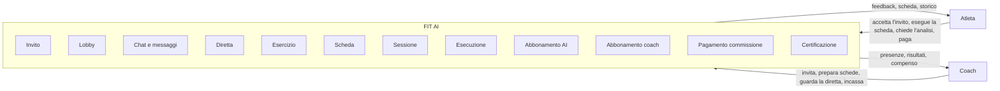

# Contesto degli obiettivi

FIT AI è un’applicazione web per controllare la correttezza degli esercizi, in palestra o a casa. Chi si allena spesso esegue uno squat, un piegamento o un plank senza qualcuno che guardi il gesto: le ginocchia chiudono, la schiena si arrotonda, la discesa resta alta, il tempo è troppo veloce. L’errore si ripete e, senza un riscontro, diventa abitudine.

Il sistema risponde a quel problema. L’atleta inquadra il movimento con la camera del proprio dispositivo. Durante la serie l’applicazione conta le ripetizioni, assegna un punteggio di forma e segnala l’errore mentre il gesto è ancora in corso. A fine serie conserva il risultato: ripetizioni svolte, punteggio, errori, eventuale perdita dell’inquadratura. L’atleta può allenarsi da solo sul catalogo pubblico oppure seguire la scheda che gli ha assegnato un coach oppure seguire una scheda generata dall'AI.

Il coach ha il problema opposto: più persone da seguire e un solo paio di occhi. Prepara gli esercizi, con il video di spiegazione e quello di esecuzione, li mette in una scheda e assegna la scheda a un atleta della propria lobby. Dalla lobby vede chi è in allenamento e, se l’atleta non ha chiuso la diretta, entra nella stanza, guarda l’esecuzione e può parlare. L’atleta resta padrone di quella scelta: con la modalità privata il coach non entra.

Un obiettivo descrive questa richiesta. Il requisito è la risposta del sistema: cosa viene creato, mostrato, aggiornato o conservato perché la richiesta sia soddisfatta.

## Clienti, prodotti, acquisti

I clienti sono le persone che usano il sito.

- **Atleta.** Si allena da solo o nella lobby di un coach. È cliente del coach, perché segue una scheda e può corrispondergli una commissione, ed è cliente della piattaforma quando usa l’analisi del movimento a pagamento.
- **Coach.** Gestisce atleti, esercizi e schede. È cliente della piattaforma per gli strumenti di lavoro (lobby, schede, diretta) e riceve il compenso dagli atleti che segue.

I prodotti sono tre.

| Prodotto | Chi lo compra | Cosa ottiene |
|---|---|---|
| Abbonamento AI | Atleta | Analisi del gesto e, nel modello concettuale, schede con origine generata dall’AI. Un rinnovo è un nuovo periodo, non la riscrittura del precedente. |
| Abbonamento coach | Coach | Uso continuato di lobby, libreria esercizi, schede e diretta. |
| Servizio del coach | Atleta, a beneficio del coach | Scheda assegnata e seguito. Il pagamento è una commissione: una quota resta alla piattaforma, il resto va al coach. |

Un acquisto esiste solo tra parti già in rapporto. La commissione si registra se atleta e coach hanno un invito accettato. La scheda generata dall’AI si registra se, alla data di creazione, l’abbonamento AI dell’atleta è attivo. Esercizi, schede e sessioni restano utilizzabili anche quando il rapporto commerciale è descritto a parte: l’acquisto abilita il servizio, non sostituisce l’allenamento.

## Diagramma di contesto

Gli stakeholder sono solo persone: l’atleta e il coach, cioè chi usa il sito. Gli altri nomi sono oggetti del sistema, non attori.

L’atleta scambia con il sistema l’invito accettato, la scheda da eseguire, il flusso della camera, il consenso alla ripresa, la scelta sulla privacy della diretta, l’acquisto dell’abbonamento AI e la commissione. Il sistema gli restituisce il conteggio, gli avvisi sul gesto, il riepilogo della serie e lo stato dei pagamenti.

Il coach scambia l’invito, gli esercizi, la scheda, l’assegnazione, l’ingresso in diretta e la certificazione che dichiara. Il sistema gli restituisce l’elenco degli atleti, chi si sta allenando, i risultati delle serie e le commissioni ricevute. La chat privata nasce da un invito accettato e contiene messaggi e videochiamate; la lobby è la conversazione di gruppo del coach con i propri atleti.
