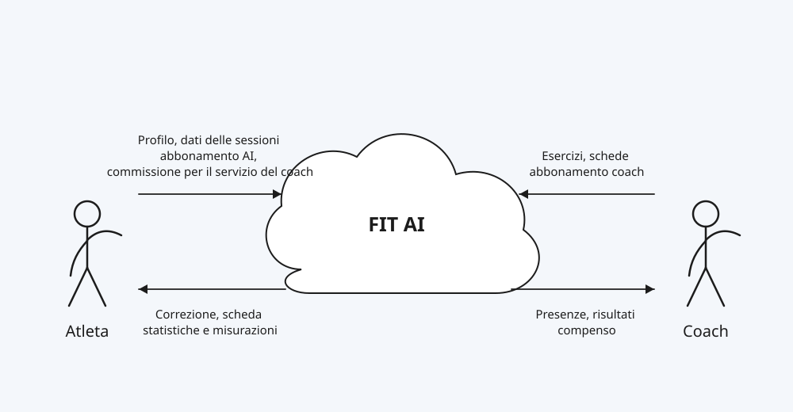

# 2. Individuazione degli stakeholder e dei goal

## 2.1 Individuazione degli stakeholder

Gli stakeholder sono i tipi di utente dell’applicazione.

- **Atleta.** Si registra, consulta il catalogo e la scheda, si allena, riceve la correzione del gesto e acquista l’abbonamento AI e il servizio del coach.
- **Coach.** Gestisce esercizi e schede, organizza gli atleti nelle proprie lobby, li segue in diretta, legge i risultati e riceve le commissioni. Paga l’abbonamento coach.

## 2.2 Diagramma di contesto

Il diagramma mostra i goal funzionali di ogni stakeholder. Al centro si trovano i goal condivisi; ai lati quelli propri di un solo stakeholder. La numerazione G1–G10 è mantenuta nel raffinamento per collegare ogni goal ai suoi subgoal.

Sono condivisi la gestione dell’anagrafica, del catalogo degli esercizi, della scheda, degli inviti, della diretta e degli acquisti, oltre alla consultazione di statistiche e misurazioni. La gestione dell’allenamento appartiene all’atleta; la gestione delle lobby e delle certificazioni appartiene al coach. All’avvio dell’allenamento, l’atleta può scegliere indipendentemente monitoraggio AI e diretta: l’AI richiede un Abbonamento AI attivo, mentre l’accesso del coach richiede un Servizio coach attivo. Se seleziona soltanto l’AI, la diretta nasce privata e può essere resa visibile durante la sessione. Senza nessuna delle due abilitazioni vengono registrate soltanto le esecuzioni. La chiusura dell’allenamento termina monitoraggio e diretta eventualmente attivi.

### Raffinamento

Per ogni stakeholder la tabella riporta i goal, i relativi subgoal e le operazioni consentite secondo la notazione CRUDS. Il codice del subgoal, per esempio G3.2, mostra immediatamente il goal padre G3.

C crea, R legge una singola istanza, U aggiorna, D elimina e S (Search) ricerca o consulta un insieme di dati. Nella colonna D, `F` indica la cancellazione fisica, `L` quella logica e `F/L` entrambe.

**Atleta**

| Stakeholder | Goal | Subgoal | C | R | U | D | S |
|---|---|---|---|---|---|---|---|
| Atleta | **G1 · Gestione anagrafica** | G1.1 · Registra la propria anagrafica | ● | | | | |
| Atleta | **G1 · Gestione anagrafica** | G1.2 · Visualizza i propri dati anagrafici | | ● | | | |
| Atleta | **G1 · Gestione anagrafica** | G1.3 · Modifica genere, altezza, peso, obiettivo e foto | | | ● | | |
| Atleta | **G2 · Gestione catalogo esercizi** | G2.1 · Consulta gli esercizi pubblici e i relativi dettagli | | ● | | | ● |
| Atleta | **G3 · Gestione scheda** | G3.1 · Visualizza la scheda attiva | | ● | | | |
| Atleta | **G4 · Statistiche e misurazioni** | G4.1 · Consulta le proprie sessioni ed esecuzioni | | | | | ● |
| Atleta | **G5 · Gestione inviti** | G5.1 · Accetta un invito e attiva l’appartenenza alla lobby indicata | | | ● | | |
| Atleta | **G5 · Gestione inviti** | G5.2 · Consulta lo stato dei propri inviti | | | | | ● |
| Atleta | **G6 · Gestione diretta** | G6.1 · Imposta o rimuove la modalità privata della diretta | | | ● | | |
| Atleta | **G7 · Gestione acquisti** | G7.1 · Acquista un abbonamento AI | ● | | | | |
| Atleta | **G7 · Gestione acquisti** | G7.2 · Annulla l’abbonamento AI modificandone lo stato | | | ● | | |
| Atleta | **G7 · Gestione acquisti** | G7.3 · Consulta i propri abbonamenti | | | | | ● |
| Atleta | **G7 · Gestione acquisti** | G7.4 · Attiva un servizio coach in una lobby | ● | | | | |
| Atleta | **G7 · Gestione acquisti** | G7.5 · Paga una commissione riferita al servizio coach | ● | | | | |
| Atleta | **G7 · Gestione acquisti** | G7.6 · Interrompe il servizio coach modificandone lo stato | | | ● | | |
| Atleta | **G7 · Gestione acquisti** | G7.7 · Consulta i propri servizi coach | | | | | ● |
| Atleta | **G7 · Gestione acquisti** | G7.8 · Consulta i pagamenti effettuati | | | | | ● |
| Atleta | **G8 · Gestione allenamento** | G8.1 · Avvia una sessione e registra l’esecuzione | ● | | | | |
| Atleta | **G8 · Gestione allenamento** | G8.2 · Avvia il monitoraggio automatico, se l’abbonamento AI è attivo | ● | | | | |
| Atleta | **G8 · Gestione allenamento** | G8.3 · Avvia la diretta, se dispone di abbonamento AI o servizio coach attivo | ● | | | | |
| Atleta | **G8 · Gestione allenamento** | G8.4 · Visualizza il feedback di correttezza, se il monitoraggio AI è attivo | | ● | | | |
| Atleta | **G8 · Gestione allenamento** | G8.5 · Chiude la sessione, l’eventuale monitoraggio AI e l’eventuale diretta | | | ● | | |

**Coach**

| Stakeholder | Goal | Subgoal | C | R | U | D | S |
|---|---|---|---|---|---|---|---|
| Coach | **G1 · Gestione anagrafica** | G1.1 · Registra la propria anagrafica | ● | | | | |
| Coach | **G1 · Gestione anagrafica** | G1.2 · Visualizza il proprio profilo | | ● | | | |
| Coach | **G1 · Gestione anagrafica** | G1.3 · Modifica genere, foto, tariffa, livello di esperienza e link social | | | ● | | |
| Coach | **G2 · Gestione catalogo esercizi** | G2.1 · Inserisce un nuovo esercizio | ● | | | | |
| Coach | **G2 · Gestione catalogo esercizi** | G2.2 · Consulta gli esercizi | | | | | ● |
| Coach | **G2 · Gestione catalogo esercizi** | G2.3 · Modifica un esercizio | | | ● | | |
| Coach | **G2 · Gestione catalogo esercizi** | G2.4 · Rimuove un esercizio dal catalogo attivo | | | | L | |
| Coach | **G3 · Gestione scheda** | G3.1 · Crea una scheda | ● | | | | |
| Coach | **G3 · Gestione scheda** | G3.2 · Consulta le schede | | | | | ● |
| Coach | **G3 · Gestione scheda** | G3.3 · Modifica serie, ripetizioni, carico, recupero e ordine | | | ● | | |
| Coach | **G3 · Gestione scheda** | G3.4 · Assegna la scheda a un atleta | ● | | | | |
| Coach | **G3 · Gestione scheda** | G3.5 · Chiude un’assegnazione | | | ● | | |
| Coach | **G3 · Gestione scheda** | G3.6 · Toglie un esercizio dalla scheda | | | | F | |
| Coach | **G4 · Statistiche e misurazioni** | G4.1 · Consulta sessioni, esecuzioni ed errori dei membri attivi delle proprie lobby con servizio attivo | | | | | ● |
| Coach | **G5 · Gestione inviti** | G5.1 · Crea un invito destinato a un atleta e a una propria lobby | ● | | | | |
| Coach | **G5 · Gestione inviti** | G5.2 · Consulta gli inviti | | | | | ● |
| Coach | **G5 · Gestione inviti** | G5.3 · Revoca un invito modificandone lo stato | | | ● | | |
| Coach | **G6 · Gestione diretta** | G6.1 · Entra nella diretta non privata di un membro attivo di una propria lobby con servizio attivo | | ● | | | |
| Coach | **G7 · Gestione acquisti** | G7.1 · Sottoscrive un abbonamento coach | ● | | | | |
| Coach | **G7 · Gestione acquisti** | G7.2 · Visualizza il proprio abbonamento | | ● | | | |
| Coach | **G7 · Gestione acquisti** | G7.3 · Consulta le commissioni ricevute | | | | | ● |
| Coach | **G7 · Gestione acquisti** | G7.4 · Consulta i servizi coach erogati | | | | | ● |
| Coach | **G9 · Gestione lobby** | G9.1 · Crea una lobby come categoria di clienti | ● | | | | |
| Coach | **G9 · Gestione lobby** | G9.2 · Consulta le proprie lobby | | | | | ● |
| Coach | **G9 · Gestione lobby** | G9.3 · Consulta i membri attivi e chi è in allenamento | | | | | ● |
| Coach | **G10 · Gestione certificazioni** | G10.1 · Inserisce una certificazione | ● | | | | |
| Coach | **G10 · Gestione certificazioni** | G10.2 · Consulta le certificazioni | | | | | ● |
| Coach | **G10 · Gestione certificazioni** | G10.3 · Modifica una certificazione | | | ● | | |

## 2.3 Scambio di valore

Lo scambio di valore è il modello di business: le entità e i flussi di valore che intercorrono tra esse.

L’atleta fornisce a FIT AI il profilo e i dati delle sessioni. FIT AI gli restituisce la correzione del gesto, la scheda e lo storico. L’atleta paga a FIT AI l’abbonamento AI e ne riceve l’analisi del movimento.

L’atleta paga la commissione per il servizio del coach. FIT AI trattiene la quota della piattaforma e versa il resto al coach. In cambio, attraverso FIT AI, il coach consegna la scheda e il seguito in diretta.

Il coach paga a FIT AI l’abbonamento coach e riceve lobby, libreria esercizi, schede e diretta. Fornisce esercizi e schede; FIT AI gli restituisce le presenze degli atleti e i risultati delle esecuzioni.

